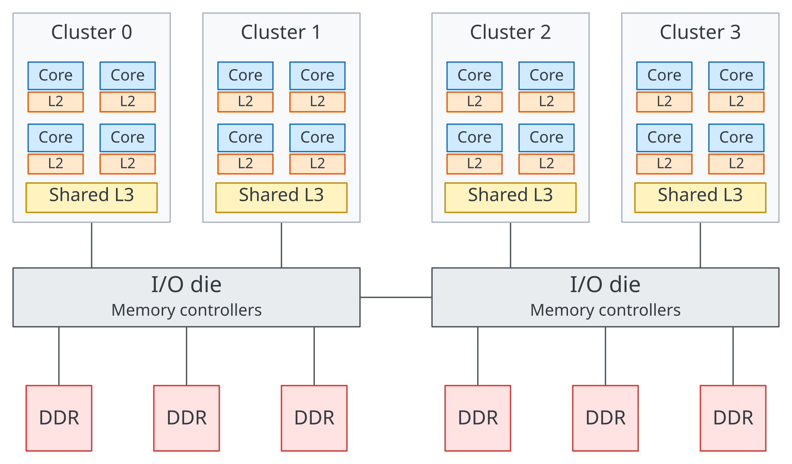
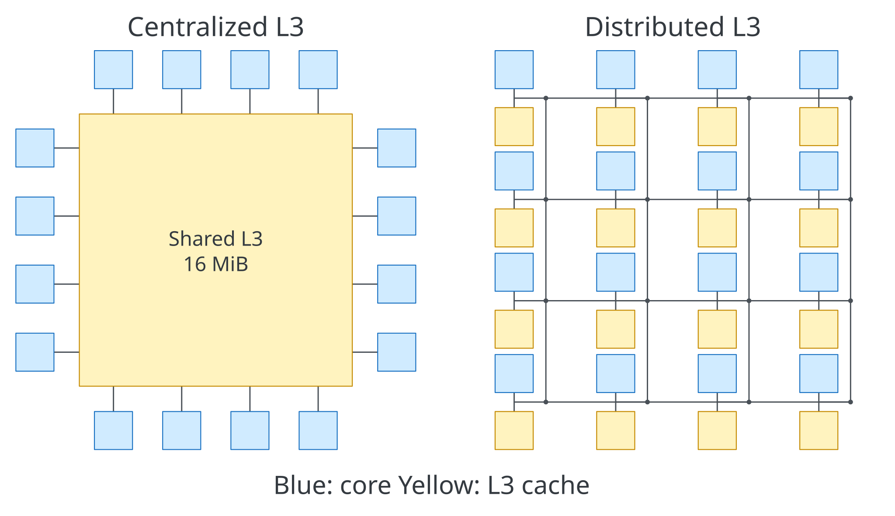
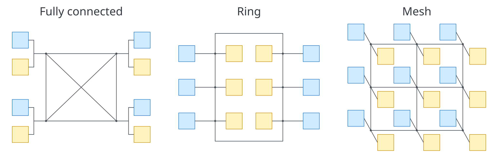
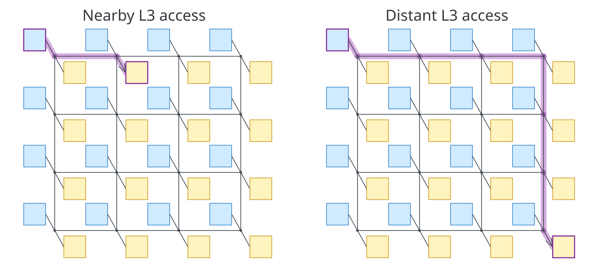
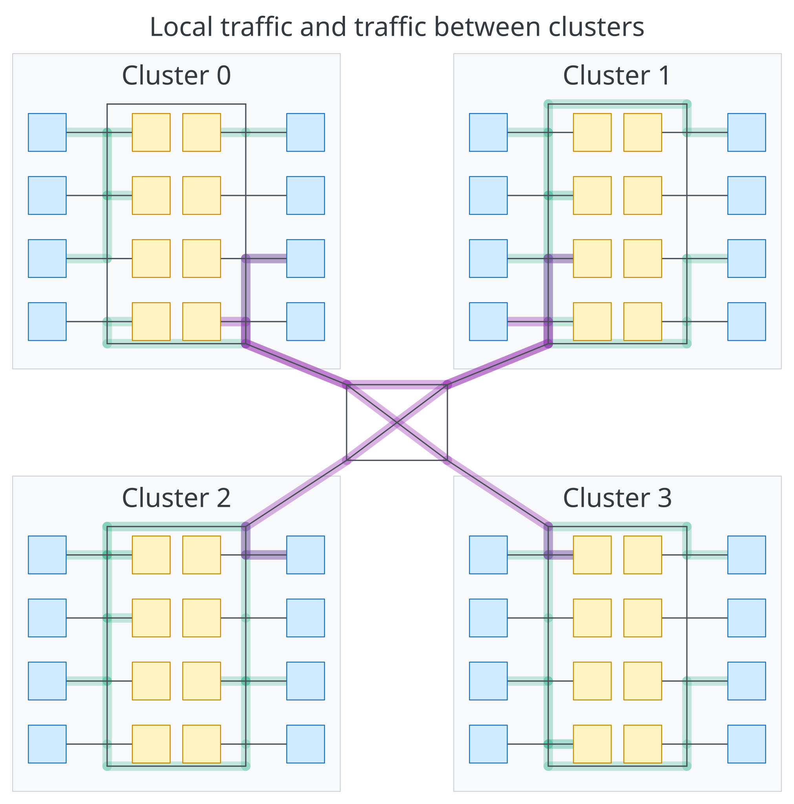

## Key takeaways

Caches are non uniform. On modern CPUs the L3 is spread across the die in slices. Each cache line address corresponds to a specific slice, and requests must travel across the interconnect to that slice. The physical location of cores, core clusters, cache slices and IO controllers on the die can impact access latency. As a result, for optimal performance, it is important to consider the cache layout of your targeted CPUs.

## Introduction

This article is a short introduction to caches and interconnects in modern processors. It assumes elementary knowledge of computer architecture. It discusses the layout of caches on modern processors, and some of the reasons why they are the way they are.

If you have feedback, please let me know - I am constantly learning and would love to discuss!

## Cache Organization

In the memory subsystem, caches, in the form of SRAM, represent the fastest types of memory on a CPU. They are often tiered, with smaller, faster, closer caches and larger, slower, and further away caches. Their purpose is to keep frequently used data close to the CPU, avoiding slower accesses to DRAM or storage.

Modern CPUs have multiple cache levels, from L1 to L2 to L3, and sometimes a system level cache.

Caches store data in fixed size cache lines, commonly 64 bytes, which are the units tracked by the cache. These lines are organized into sets and ways, and larger caches may also be physically divided into smaller banks or slices.

L1 caches are often split into instruction and data caches and are generally private, meaning each CPU core has its own distinct block of L1 cache. On many modern high performance CPUs, L2 caches are private as well, though some implementations share an L2 cache across a cluster of cores. L3 caches are generally shared amongst multiple CPU cores, allowing them to access data in the shared last level cache without the need to go out to DRAM.

{.cache-layout-diagram fig-alt="Four core clusters with blue cores, orange private L2 caches and yellow shared L3 caches, connected through two I/O dies to DDR memory."}

On CPUs with a private L2, the core often connects to the rest of the system through its L2 controller and coherence interface. From the interconnect's point of view, that interface sends memory requests and responds to coherence messages: the CPUs are just a bunch of L2s. In some scenarios, data transfers originating from L2 are faster than ones originating in L1, because retrieving data in the L1 requires moving it to the L2 first.

## Distributing Cache {#distributing-the-last-level-cache}

For the next example, assume we have a hypothetical 16 core CPU with 16 MiB of shared L3 cache. We will use this as a simple example to illustrate how the cache might be organized and how requests move through the processor.

To implement this large cache, the simple method would be to have a large block of cache, and connect each core to it. However, as core counts and cache sizes increase, it becomes difficult to optimally position cores to be close to the L3. Thus, on modern CPUs, caches are sliced up and spread across the chip. This allows for natural scalability - it is easier to increase core counts and cache size.

{.cache-layout-diagram fig-alt="Sixteen cores connected to one central 16 MiB L3, compared with sixteen shared 1 MiB L3 slices connected through a mesh."}

## Interconnects

One of the most important parts of a modern processor, along with the memory subsystem and the core itself, is the fabric, or interconnect. It carries requests and data between cores, cache slices, and IO. There are multiple different ways to implement an interconnect. For small clusters, a fully connected network can give every endpoint a direct link to every other endpoint, allowing for lowest latency, but its complexity grows quickly.

An alternative, used by Intel's client CPUs, is to connect cores, memory, and IO on a ringbus. The ringbus acts as a central highway, which means each core only needs one (or two, for a bidirectional ringbus) connection. While each additional "stop" on the ringbus increases the length and thus latency, it allows for easier scaling than a fully connected network.

However, a single ring results in ever increasing latency as size increases. The modern solution to this is to use a mesh interconnect. This allows for communication in a 2D grid. Requests travel across horizontal and vertical links, providing more paths for traffic than a single ring. Tilera historically used a mesh interconnect, with [Intel server CPUs from Skylake to Granite Rapids](https://www.intel.com/content/www/us/en/developer/articles/technical/xeon-processor-scalable-family-technical-overview.html) and modern Arm server CPUs utilizing this approach, for its scalability.

{.interconnect-diagram fig-alt="Fully connected, ring, and mesh interconnects, with blue cores and yellow L3 slices."}

While mesh processors can scale well, they still have the problem of increasing distance and latency as core counts increase. Another way of scaling the interconnect is to organize it in levels. Within one cluster, you may have a crossbar, ring, or mesh. A separate interconnect then connects multiple clusters with each other. This "tiered" system allows for lower complexity and distance at the local level, while still maintaining scalability at the higher level.

## Homing

How does a CPU core know which slice of L3 is responsible for the address it is requesting? In a system with distributed mesh nodes, each physical address maps to a home that coordinates coherence for that address. This mapping is often done by a hash that tells the CPU core which home to send the request to. The home also keeps track of where copies may exist (tracking the MESI+ status) and which cache may hold the latest data.

When a core issues a read for an address that misses its private caches, the request is sent to the home node. The home node then checks the coherency status, and sends a request to the local L3, another core, or to the DRAM controller. The exact behavior depends on the coherence protocol and implementation. Intel describes this coordination in its [core to core communications overview](https://www.intel.com/content/www/us/en/developer/articles/technical/fast-core-to-core-communications.html).

Examples of this role include Intel's Caching and Home Agent (CHA) and Arm's [home nodes (HN-F and HN-S)](https://developer.arm.com/documentation/108055/0301).

## Nonuniformity

The locations of cores, home nodes, and cache slices determine the paths requests take through the interconnect. Requests sent to closer L3 slices take less time than requests sent to further slices.

{.mesh-comparison fig-alt="Two identical 4 by 4 meshes showing a nearby and a distant L3 access from the same core, with paths highlighted in purple."}

On an Intel Ice Lake Xeon Gold 6314U, with a 6 by 8 mesh, cache access latency can be nearly twice as long due to the increased physical distance. Cache hits within the core's corresponding slice take 20 ns, while tiles further away take around 1 ns per vertical and 2 ns per horizontal hop.[^method] This also means that cores in the center have lower average distance and thus lower average latency to each cache slice, while corner cores perform worse.

<figure class="wide">

The interactive version needs JavaScript.

<figcaption>L3 hit latency on the mesh, in nanoseconds: from one core to every slice, or each core's average</figcaption>
</figure>

For accesses spread across large arrays, these differences average out and prefetching can also hide this latency for predictable access patterns.

## Chiplets

Another approach taken by modern CPUs is to utilize multiple pieces of silicon, or "dies", for scalability. This often involves stacking different interconnects on each other. Crossing these silicon domains can result in a noticeable latency penalty. CPUs built from multiple dies include AMD's EPYC processors, as well as some Intel processors, such as Sapphire Rapids with its 4 compute dies.

AMD's [Zen 3 EPYC 7003 processors](https://docs.amd.com/v/u/en-US/overview-amd-epyc7003-series-processors-microarchitecture), for example, group up to 8 cores around a shared L3 within each CCX. Each compute die (CCD) contains one CCX, and the CCDs connect to each other through the I/O die. Communication within a cluster is fast, while communication between clusters takes longer. Keeping communications local can improve performance significantly.

Example: local rings connected through a larger network

The diagram below illustrates the hierarchy with local rings and a shared outer network.

{.cluster-diagram fig-alt="Four local ring clusters connected through a larger network. Green requests stay within their clusters, while purple requests travel between clusters."}

## Conclusions

Modern manycore processors do not have a uniform cost for cache and data access. The cost depends on the layout of cores, caches, and IO, and varies widely depending on microarchitecture and implementation. For optimal performance, it is important to consider the physical layout and design of the chip.

Thanks for reading! The next article, [Core to Core is not Core to Core](https://jacen.li/writings/core-to-core-is-not-core-to-core/), explains some of the resulting impact of homing with regards to core to core communications.

[^method]: Every load is made to miss the L1 and L2 and hit one chosen slice, with the clocks at full speed. The absolute numbers run 2 to 3 ns high because each test keeps a single slice busy; the differences between tiles are the result.
