<!-- Jacen's rewrite, 2026-10-29, kept verbatim except typo and correctness fixes listed in the EDIT notes. article_draft.md is the long version with every table and source note. Figures and footnotes placed where the notes asked. -->
# Core to Core is not Core to Core

## Key takeaways

Core to core latency is not only a function of cores A and B, but also a function of physical address. (At least on mesh based and some Intel ringbus based processors.) This is because coherency is handled at "homes" distributed across the interconnect. Especially on modern large processors, changing addresses can result in a best vs worst case latency of 40 ns to 60 ns. In this article, I discuss how I discovered, measured, and exploited this behavior.

## Core to core latency

Core to core (c2c) latency is critical for multithreaded tasks with handoffs. There are already many existing benchmarks to measure it.[^tools]

However, some of these benchmarks, particularly ones that use a single address, hide a hardware behavior. Running an example benchmark on a fixed pair of CPUs shows very high run to run variance. Here is a comparison of several "cas" based benchmarks, each run 100 times on CPUs 0 and 1:

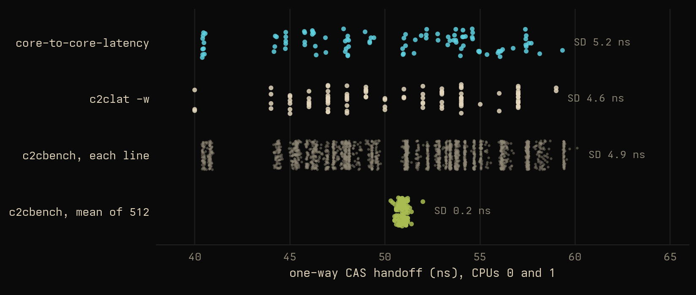

With a standard deviation of ~5 ns and a range of up to 20 ns, it is hard to trust running each benchmark only once. By understanding why this behavior exists, I was able to create a more consistent benchmark and understand a hardware behavior that we can take advantage of. What if we made core to core latency not ~50 ns on average, but 40 ns? Homing is key.

## Homing

<!-- EDIT: fixes in this section: B requests (A/B naming), "on this chip" for "on intel systems", DCT as what CHI allows, "While, you", "a intuitive"; the route capture paragraph from the earlier draft is kept (figure cut 2026-10-29: it repeated the chase animation) between "lack thereof" and "So the four steps", since that is the measurement those sentences announce. -->
As you may recall from [my last article on caches](https://jacen.li/writings/caches-and-interconnects/), on a modern CPU like this one, the L3 is split into slices to be more easily managed. On this specific processor, there is one slice and an accompanying coherency "manager" per tile of the mesh. Every physical address is assigned to exactly one slice by a hash of its address bits.[^hash] That slice, and the coherence agent sitting with it, is the address's home, H. The home is where the chip keeps track of who has the line.

When CPU B wants to read an address X, it does not know who else has a copy of it. While you could have a scoreboard that manages this information in CPU B, this itself would be quite complicated to sync between every core. As a result, when a request is sent for an address, the request is sent to the home, which knows which other cores have ownership of the line. It then sends a snoop to that other core, which then sends the data back to the home which forwards it back to the core (or directly back to the requesting core in the case of direct cache transfer, which [AMBA CHI](https://developer.arm.com/documentation/ihi0050/latest/) allows). Having the home as one "bookkeeper" greatly simplifies things for processor architects.

We can measure this behavior using mesh performance counters. On this chip, the path traffic takes through the mesh is always vertical first, then horizontal. We can also measure the existence, or lack thereof, of direct cache transfer, which seems like an intuitive optimization.

However, this hardware optimization is not utilized on this CPU. Using mesh counters, I did not see any evidence of direct cache transfer, and instead, all data was forwarded through the home.

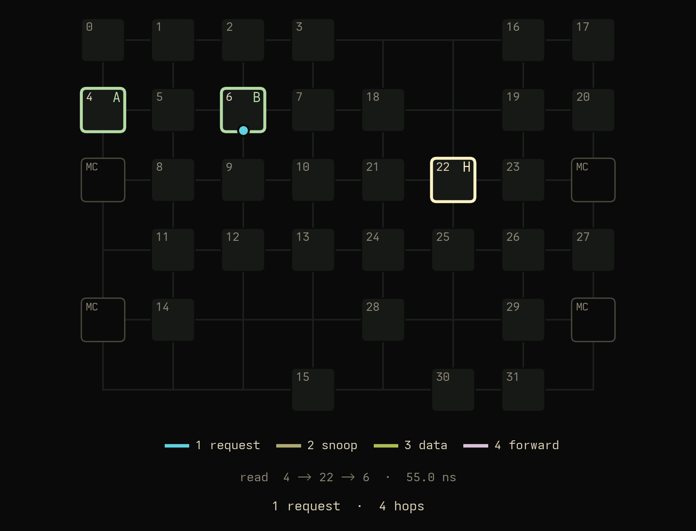

The distance that matters is

$$
D = d(B,H) + d(H,A)
$$

Note that the distance between A and B actually does not matter, in and of itself. Two closer cores are only partly faster, because each core to core transfer is actually a core to home to core transfer. I measured this behavior across every combination of core A, core B, and home H across the processor, and fit the total mesh distance via the formula above against the resulting latency:[^clocks]

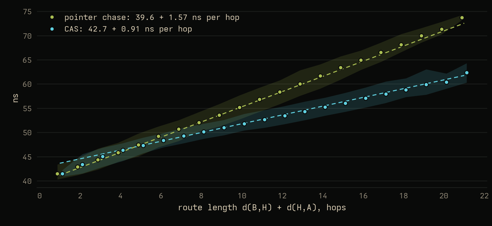

<details class="wide">
  <summary>Explore: by route length</summary>
  <div data-fit-src="figures/fit/fit.json"><p class="widget-nojs">The interactive version needs JavaScript.</p></div>
</details>

For synchronization, you only use one address, and the latency is thus a function of the address as well as the cores. This interactive diagram shows the core to core latencies for each home when you define cores A and B. As you can see, further ones out are higher latency.

<figure class="wide">
  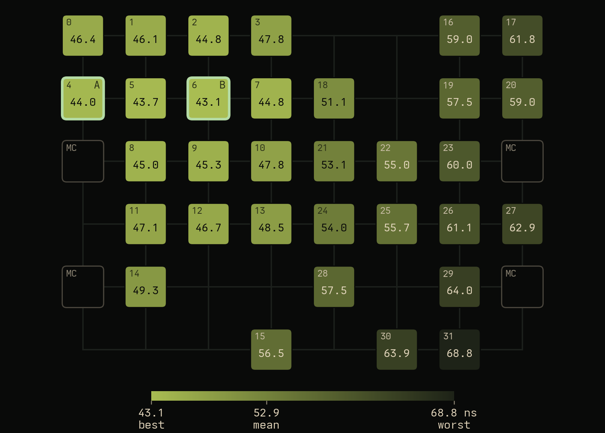
  <figcaption>CPU 4 to CPU 6: latency for every possible home</figcaption>
</figure>

<details class="wide">
  <summary>Explore: set two of A, B and H</summary>
  <div data-mesh-explorer data-src="figures/explorer/diomedea.json" data-a="4" data-b="6"><p class="widget-nojs">The interactive version needs JavaScript.</p></div>
</details>

Now back to the 100 c2c latency runs. The multimodal behavior we saw earlier actually shows us this homing behavior: each mode is actually one home. And while the standard deviation of these core to core latency tests is ~5 ns, with a fixed home, the std drops to 0.1 ns! Almost all of the run to run variation is caused by homing variation, not other things.

<figure class="wide">
  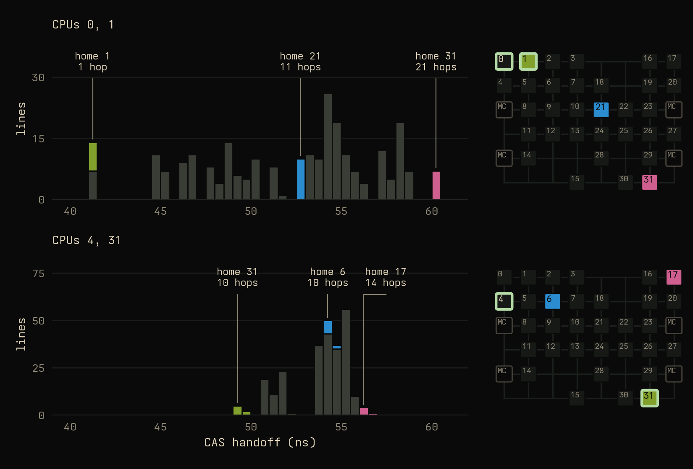
  <figcaption>Which home each line landed on</figcaption>
</figure>

<details class="wide">
  <summary>Explore: pick a home</summary>
  <div data-homes-src="figures/homes/homes.json" data-a="0" data-b="1"><p class="widget-nojs">The interactive version needs JavaScript.</p></div>
</details>

Of course, for some core pairs, picking a home matters less, for example, corner pairs: when A and B are far apart, almost every home lies close to the path between them, so the homing effect is less. The effect is greatest on neighbours, since they can have a home close to their own tiles or across the die.

## What is the number?

So what is "the" latency between two cores? There isn't one. There is one per home, 32 of them for this specific processor, and you get whichever you are allocated. Now, reporting the average or tail results can be valuable: as a programmer, you cannot control what physical address you get, so you can optimize for average, best, or worst case.

So how can you get these results? You can loop other single address "cas" benchmarks multiple times, but I believe that having a benchmark that has this multi address behavior as a first class priority is better, as it can guarantee different address locations instead of hoping the OS gave you different addresses, as well as sharing overhead for faster runs, which matters as processors scale to hundreds of cores.

By averaging over many addresses, we can change the result from one line to the average line. Here are 1 to 4096 lines per trial, 1024 trials each, every trial the same million handoffs:

<!-- EDIT: interactive: figures/pool/pool.css in <head>, figures/pool/pool.js at the end of <body>; the PNG inside is the fallback. -->
<figure class="wide">
  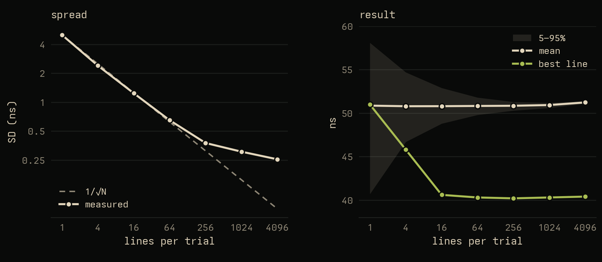
  <figcaption>More lines per trial, less spread</figcaption>
</figure>

<details class="wide">
  <summary>Explore: lines per trial</summary>
  <div data-pool-src="figures/poolsweep.json"><p class="widget-nojs">The interactive version needs JavaScript.</p></div>
</details>

The mean does not move, but the spread falls as 1/√N to a floor of around 0.3 ns, which is the run to run noise. And by 16 to 64 lines, the fastest line in the pool is on the best home, 21% below the mean.

## How core to core latency is measured

So, I've kind of glossed over how core to core latency is actually measured: I've mentioned CAS, but how do we actually make a good benchmark?

First, we need to ensure we are actually measuring core to core transfers. The line must actually be in A's private cache, and B must not have a copy. Next, we have to make it so it's actually measurable: one transfer is ~50 ns, and at that scale, timer overhead is a significant source of error, so each sample times a whole block of 200 round trips or 255 hops. Here are two solutions that I have decided on.

1. Transfer one cache line, many times.
2. Transfer many cache lines, once each.

For the one line, many times route: once B has a line, the next read would just hit in its own cache. Thus, A and B must alternate, which means B has to tell A it is done, which is another core to core transfer. But there is an optimization: we can use the atomic compare and swap ("cas") operation to send that message on the same line. Check that the other core changed the value, and if so, change it back.

```text
A: repeat R times: retry CAS(turn, 2r -> 2r+1) until it succeeds
B: repeat R times: retry CAS(turn, 2r+1 -> 2r+2) until it succeeds
```

One round is one change by A and one by B, so one way latency = elapsed / 2R. This is a common approach: `c2clat -w` and `core-to-core-latency` use it too; mine, [c2cbench](https://github.com/jtl06/c2cbench), times each line on its own.

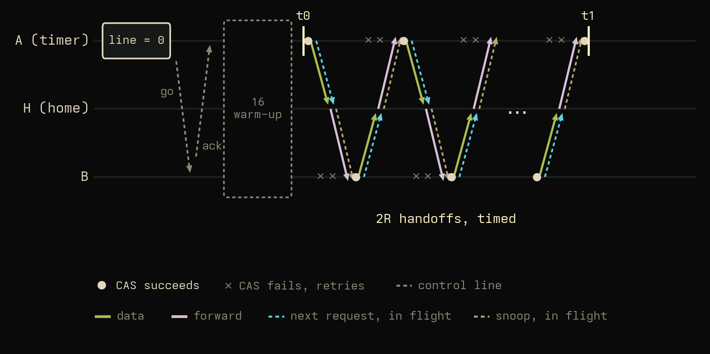

Now, the other approach: many lines, once each. This can be done through the classic dependent pointer chase, which is often used for memory load latency tests such as lmbench's [lat_mem_rd](https://github.com/intel/lmbench) and [Intel MLC](https://www.intel.com/content/www/us/en/developer/articles/tool/intelr-memory-latency-checker.html): A writes a linked list, one node per cache line, then B follows it and we divide by the hops. Each load needs the previous one's value, so nothing overlaps, and nothing is passed back, with the list in another core's cache.

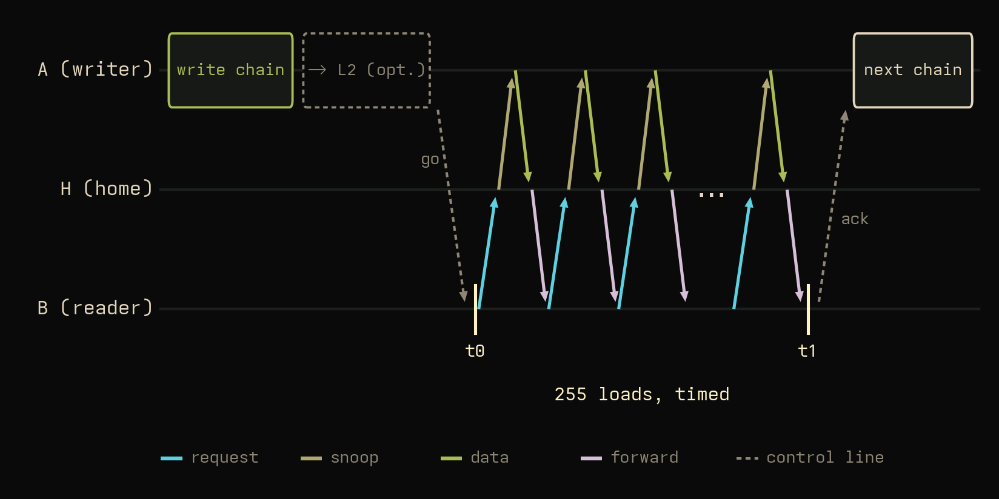

Each of these two benchmarks measures a different thing, an alternating handoff and a dependent read, so don't expect the same number. And they don't. As you may recall from earlier, the graph shows two different slopes: CAS costs 0.91 ns per hop of D, the chase 1.57.

## Why CAS is cheaper per hop

The pointer chase benchmark is slightly slower, because it serializes all four steps: request, snoop, data, forward. In the tight CAS loop, I believe that since the cores constantly retry the moment the CAS fails, a request is always in flight. Thus, only the data legs, A → H → B, are on the critical path. With this accounted for, a single cost per mesh traversal, 0.80 ns, fits both benchmarks: the chase pays it twice per hop of D (1.57 ns), CAS once (0.91 measured, against 0.79 predicted).

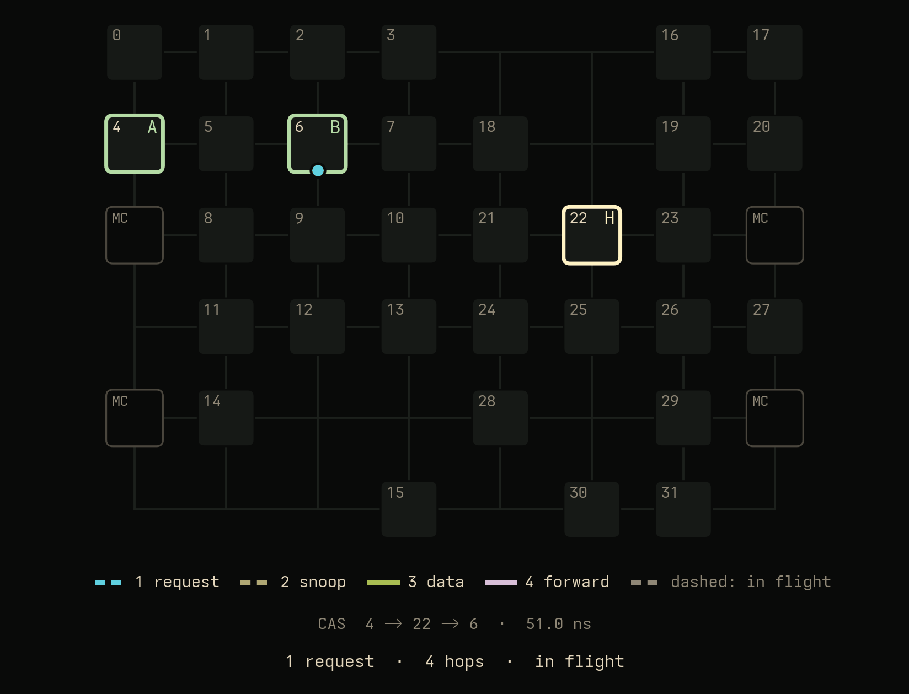

## Getting the chase right

Now, creating a dependent pointer chase benchmark is slightly more difficult than the CAS route. This is due to hardware features.

**Prefetchers.** Prefetchers are designed to make memory accesses faster, but we actually want to keep them slow. To do this, the traversal must not be predictable. Random order across a large span handles the spatial prefetcher. But on some modern (Arm) processors, there is actually a prefetcher, the CMC ([Hot Chips 33](figures/images/hotchips33-neoverse-n2-cmc.png)), that can remember previous cache misses. To defeat this intelligent, "temporal" prefetcher, I designed the benchmark to never repeat a chain. The impact of prefetchers can be checked by disabling them: on the Xeon, turning all four prefetchers off moves the result by 0.1 ns. On Graviton, a previous version of the benchmark was susceptible to CMC prefetching.

**Where the line sits.** Now, I have mentioned that to the interconnect, CPUs are merely a bunch of L2 caches. As a result, a line pulled from A's L2 arrives 2.5–3 ns sooner than from A's L1, on the Xeon and on both Gravitons. So, we can measure latency starting from L1 or L2 by selectively controlling the size of the chain, as well as evicting lines sitting in A's L1 to the L2 before the snoop can be answered. Past A's L2 it is not core to core any more: the lines get evicted to the L3, which sits on the mesh.

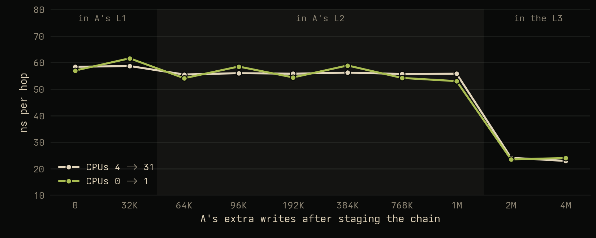

## Other machines

<!-- EDIT: Granite Rapids and Graviton5 measured 2026-10-29 (c2c-research results/c8i-metal-48xl, c9g-metal-48xl, c7i-metal-24xl, c8g-metal-24xl/20261029-place/c2cbench-cas.csv: c2cbench CAS, per line, physical cores on one die; best and worst line of the typical pair = medians over pairs; within-pair range max 54-76 ns). Ampere and Nvidia stay as expectation. -->
The behavior described in this article is generally present on mesh based processors as well as ringbus processors. Measured here: Sapphire Rapids, Granite Rapids, Graviton4 and Graviton5. I expect the same on Ampere, and probably Nvidia (please let me know if you can get me access to a Grace or Vera machine to test). Example data, best to worst line of a typical pair on one die, one way: Sapphire Rapids (four chiplets) 49 to 72 ns. Granite Rapids (6975P-C, three dies) 89 to 118 ns. Graviton4 (Arm CMN) 39 to 53 ns. Graviton5 53 to 83 ns, plus the prefetcher above. The widest pairs span 50 to 75 ns.

AMD Zen processors with their own sub chiplets are not as impacted due to the smaller size of the core complexes: within a chiplet the lines are flat and placement gains 0–4%; across chiplets latency is about 6× and does vary per line.

## Choosing the line

I mentioned earlier how you cannot control the physical address you get. This was kind of a lie. There are ways to pick and choose certain "fast addresses". The simplest way is to use root to read the physical address, and use the hashing algorithm and the physical layout of the chip to know where to place things. But you can also empirically measure this: select a bunch of addresses, test them, and pick the "fast" ones. Timing 512 candidate addresses for each hot line with CAS takes about 0.1 s.

<figure class="wide">
  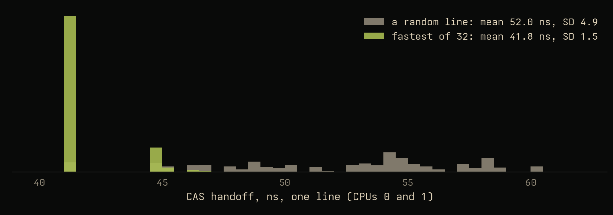
  <figcaption>CAS per line for CPUs 0 and 1: a random line, and the fastest of 32</figcaption>
</figure>

<details class="wide">
  <summary>Explore: allocate a line</summary>
  <div data-lottery-src="figures/homes/homes.json"><p class="widget-nojs">The interactive version needs JavaScript.</p></div>
</details>

### What can we do with this?

If the home moves c2c latency by 12–34 ns, then what if we used the best one every time? Using these fast addresses for each core to core workload, such as a queue's head and tail, or a lock/flag, we can significantly improve performance.

I designed a custom allocator (as part of a library I'm working on to take advantage of homing in other workloads) to place the hot lines of a [rigtorp::SPSCQueue](https://github.com/rigtorp/SPSCQueue) on "fast addresses". This cut round trip latency by ~12 to 38%. Testing multiple core pairs across several bare metal systems[^method] shows this generalizes: fast address placement won 149 of 160 rounds on Ice Lake and 155 to 160 of 160 on the others. Tail performance also improves. Default allocation is a lottery: some core pairs and address allocations can have a fast result, but a pair's round trip latency has an SD as high as 53 ns run to run, as the queue lands on different lines at different homes. Using the fast placement, we drop that SD down to 1 to 3 ns (13 on Ice Lake).[^states] A random spot in the same arena does nothing, so it is the timing, not the layout. Granite Rapids and Graviton5 split the socket into NUMA nodes, and on those processors, the node where the address is homed matters as well.[^numa] Fast placement helps most for pairs on one die: 14% and 37%, against 9% and 28% across dies.

<!-- EDIT: table, figure and widget from the final runs, 2026-10-30 (c2c-research results/diomedea/20261030-final/SUMMARY.md: diomedea, c7i-metal-24xl, c8i-metal-48xl, c8g-metal-24xl, c9g-metal-48xl/20261030-final/rigtorp10.csv). queues_place, 16 pairs x 10 rounds, 1M round trips; one process per pair pinned to the producer (EC2) so all memory is on the producer's node; a fresh default every round; placed = cas-lines: the queue object and its slot array each at the fastest of 512 candidate addresses by CAS on the pair (~0.1 s). Per pair the median over rounds, then medians over pairs; changes are medians of per-pair ratios; rounds won = rounds where placed beat default; run-to-run SD = population SD of a pair's 10 round medians, median over pairs. Dies: Granite Rapids NUMA nodes (CPUs 0-31, 32-63, 64-95), Graviton5 0-95 / 96-191. Ice Lake's placed SD is a two-state spin-loop effect (results/diomedea/20261030-states). Xeon 6314U at load clocks, EC2 at default clocks. figures/placement_data.py builds placement.json. Widget: figures/place/place.css in <head>, figures/place/place.js at the end of <body>; the PNG inside is the fallback. -->
<div class="table-scroll" markdown="1">

| Machine | Default | Placed | Median | p99 | p99.9 | Rounds won | Run-to-run SD |
|---|---|---|---|---|---|---|---|
| Ice Lake (6314U) | 387 ns | 335 ns | -15% | -15% | -9% | 149/160 | 25 → 13 ns |
| Sapphire Rapids (8488C) | 488 ns | 306 ns | -38% | -32% | -28% | 160/160 | 53 → 2 ns |
| Granite Rapids, 3 nodes | 537 ns | 482 ns | -12% | -8% | -12% | 158/160 | 24 → 3 ns |
| · same die, 6 pairs | 439 ns | 379 ns | -14% | -12% | -15% | 59/60 | 25 → 2 ns |
| · cross die, 10 pairs | 621 ns | 552 ns | -9% | -7% | -11% | 99/100 | 24 → 6 ns |
| Graviton4 | 268 ns | 206 ns | -19% | -20% | -17% | 155/160 | 19 → 1 ns |
| Graviton5, 2 nodes | 355 ns | 231 ns | -36% | -19% | -12% | 159/160 | 50 → 1 ns |
| · same die, 8 pairs | 306 ns | 190 ns | -37% | -21% | -14% | 80/80 | 39 → 2 ns |
| · cross die, 8 pairs | 398 ns | 294 ns | -28% | -14% | -10% | 79/80 | 51 → 1 ns |

</div>

<figure class="wide">
  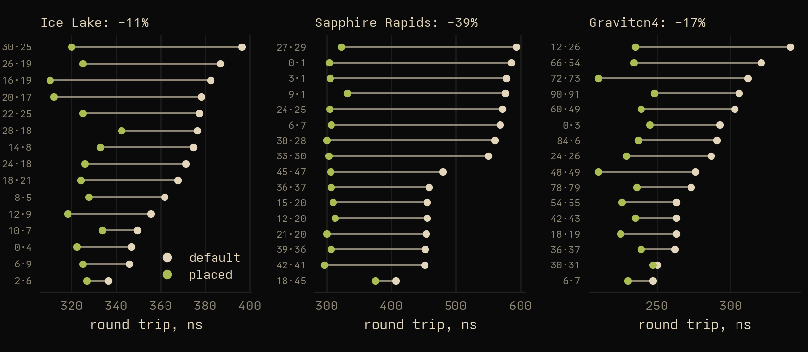
  <figcaption>rigtorp SPSC queue round trips per pair, default and placed; bands are the range over 10 rounds</figcaption>
</figure>

<details class="wide">
  <summary>Explore: per pair, per machine</summary>
  <div data-place-src="figures/placement.json"><p class="widget-nojs">The interactive version needs JavaScript.</p></div>
</details>

## Conclusion

So what is core to core if not core to core? It's core to home to core, and we can measure and take advantage of this. With [c2cbench](https://github.com/jtl06/c2cbench), you have 2 options to measure core to core latency: with CAS, an average over alternating handoffs of one line, and you can see the distribution of core to core latencies per pair; with the chase, dependent reads of many lines, allowing for unidirectional measurement, but giving up precise home behavior.

But what ultimately mattered for me is thinking about why numbers are the way they are. Why does a core to core microbenchmark have such high std? How can we fix this? How can we take advantage of this? And what else is like this?

Thank you for reading. I hope you enjoyed this article, and if you have any thoughts, questions, or comments, please [contact me](mailto:jacenli@icloud.com)!

[^tools]: [core-to-core-latency](https://github.com/nviennot/core-to-core-latency) (nviennot), [c2clat](https://github.com/rigtorp/c2clat) (rigtorp), [Intel MLC](https://www.intel.com/content/www/us/en/developer/articles/tool/intelr-memory-latency-checker.html), [multichase](https://github.com/google/multichase) (Google), [CnC-Tools](https://github.com/ChipsandCheese/CnC-Tools) (Chips and Cheese) and [ASCT](https://learn.arm.com/install-guides/asct/) (Arm). Disclosure: I worked on ASCT during an internship at Arm.

[^hash]: On the Xeon 6314U, the home hash is an XOR of PA bits 6 to 36, using McCalpin's research [Mapping Addresses to L3/CHA Slices in Intel Processors](https://repositories.lib.utexas.edu/bitstream/handle/2152/87595/TR-2021-03_IntelAddressHashing.pdf), and checked with the CHA counters. Tile positions follow Cho, [Know Your Neighbor](https://ieeexplore.ieee.org/document/9774708/) (DATE 2022).

[^clocks]: The Xeon 6314U numbers are at full load clocks: cores at their turbo limit (about 3.4 GHz with two busy) and the mesh at 2.2; cloud machines ran at defaults. Power management can leave the mesh at 0.8 GHz, which ~triples the per hop cost.

[^method]: 16 core pairs per machine. Each pair ran 10 rounds of a million round trips, with a new queue allocated each round behind a random-size heap allocation, so the queues land on different lines. Placed: the queue's index and slot lines at the fastest of 512 candidates by CAS.

[^states]: On Ice Lake the queue flips between two speeds 40 ns apart, on most pairs, whatever the lines. The cause is the L2 adjacent-line prefetcher, which fetches 64-byte lines in 128-byte pairs. rigtorp pads its indices to 64 bytes, so the producer's private copy of the read index shares a pair with the consumer's read index, and the prefetchers pull that pair between the two cores on every message: about two extra line transfers per round trip. Which speed a run gets varies from process to process, and a short pause between polls makes the faster one more likely. Padding to 128 bytes removes the problem: 18% faster (median over 22 pairs), with no tuning.

[^numa]: Remote memory cost Graviton5 1.3× and Granite Rapids up to 2× per round trip. Memory is allocated on a first touch basis, so each pair ran in its own process on the producer core, keeping all of it on the producer's node.
