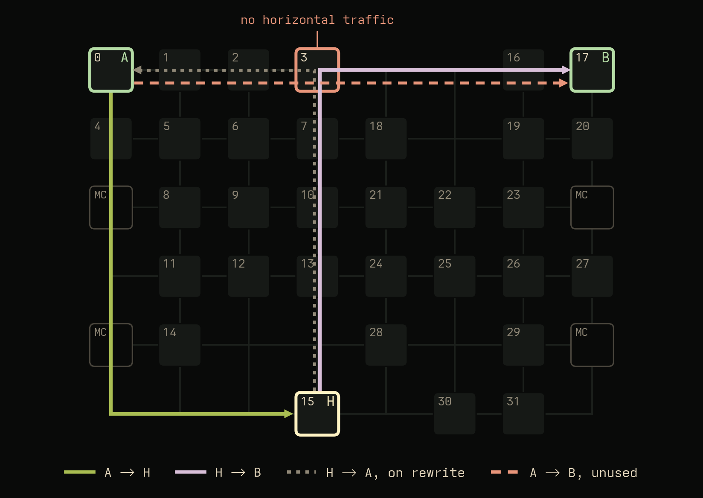

<!-- Jacen's rewrite, 2026-10-29, kept verbatim except typo and correctness fixes listed in the EDIT notes. article_draft.md is the long version with every table and source note. Figures and footnotes placed where the notes asked. -->
# Core to Core is not Core to Core

## Key takeaways

Core to core latency is not only a function of cores A and B, but also a function of physical address. (At least on mesh based and some Intel ringbus based processors.) This is because coherency is handled at "homes" distributed across the interconnect. Especially on modern large processors, changing addresses can result in a best vs worst case latency of 40 ns to 60 ns. I discuss how I discovered it, measured it, and exploited this behavior for performance and consistency improvements.

## Core to core latency

Core to core (c2c) latency is critical for multithreaded tasks with handoffs. The faster two cores can communicate, the lower overhead exists when multithreading tasks. To measure core to core latency, there are already many existing benchmarks.[^tools]

However, I believe some of these benchmarks, particularly ones that utilize a single address, are flawed. Running an example benchmark on a fixed pair of CPUs shows very high run to run variance. Here is a comparison of several "cas" based benchmarks, each run 100 times on CPUs 0 and 1:


With a standard deviation of ~5 ns and a range of up to 20 ns, it is hard to trust running each benchmark only once! I was deeply intrigued by why there could be such high variance on a quiet system, and by understanding why this behavior exists, I was able to not only create a more consistent benchmark, but understand a hardware behavior that we can take advantage of. What if we made core to core latency not ~50 ns on average, but 40 ns! Homing is the key.

## Homing

<!-- EDIT: fixes in this section: B requests (A/B naming), "on this chip" for "on intel systems", DCT as what CHI allows, "While, you", "a intuitive"; the route capture paragraph and figure from the earlier draft are kept between "lack thereof" and "So the four steps", since that is the measurement those sentences announce. -->
As you may recall from [my last article on caches](https://jacen.li/writings/caches-and-interconnects/), on a modern CPU like this one, the L3 is split into slices to be more easily managed. On this specific processor, there is one slice and an accompanying coherency "manager" per tile of the mesh. Every physical address is assigned to exactly one slice by a hash of its address bits.[^hash] That slice, and the coherence agent sitting with it, is the address's home, H. The home is where the chip keeps track of who has the line.

When CPU B wants to read an address X, it does not know who else has a copy of it. While you could have a scoreboard that manages this information in CPU B, this itself would be quite complicated to sync between every core. As a result, when a request is sent for an address, the request is sent to the home, which knows which other cores have ownership of the line. It then sends a snoop to that other core, which then sends the data back to the home which forwards it back to the core (or directly back to the requesting core in the case of direct cache transfer, which CHI allows[^dct]). Having the home as one "bookkeeper" greatly simplifies things for processor architects.

We can measure this behavior using mesh performance counters. On this chip, the path traffic takes through the mesh is always vertical first, then horizontal. We can also measure the existence, or lack thereof, of direct cache transfer, which seems like an intuitive optimization.

On this chip it does not happen. I picked two cores on the same row, A = 0 and B = 17, and lines homed at H = 15, five rows below, and watched the mesh's ring counters. Column 3 was busy, and tile 3, which sits on the direct row 0 path, saw no horizontal data at all:



So the four steps are request B → H, snoop H → A, data A → H, data H → B. Every one of them touches H:


The distance that matters is

$$
D = d(B,H) + d(H,A)
$$

Note that the distance between A and B actually does not matter, in and of itself. While you might think that two closer cores would be faster, this is only partly true, because each core to core transfer is actually a core to home to core transfer. I measured this behavior across every combination of core A, core B, and home H across the processor, and fit the total mesh distance via the formula above against the resulting latency:


For synchronization, you only use one address, and the latency is thus a function of the address as well as the cores. I've created this interactive diagram to show the core to core latencies for each home when you define cores A and B. As you can see, further ones out are higher latency.

<figure class="wide">
  
  <figcaption>CPU 4 to CPU 6: latency for every possible home</figcaption>
</figure>

<details class="wide">
  <summary>Explore: set two of A, B and H</summary>
  <div data-mesh-explorer data-src="figures/explorer/diomedea.json" data-a="4" data-b="6"><p class="widget-nojs">The interactive version needs JavaScript.</p></div>
</details>

Now back to the 100 c2c latency runs. The multimodal behavior we saw earlier actually shows us this homing behavior: each mode is actually one home. And while the standard deviation of these core to core latency tests is ~5 ns, with a fixed home, the std drops to 0.1 ns! Almost all of the run to run variation is caused by homing variation, not other things.

<figure class="wide">
  
  <figcaption>Which home each line landed on</figcaption>
</figure>

<details class="wide">
  <summary>Explore: pick a home</summary>
  <div data-homes-src="figures/homes/homes.json" data-a="0" data-b="1"><p class="widget-nojs">The interactive version needs JavaScript.</p></div>
</details>

Of course, for some core pairs, picking a home matters less, for example, corner pairs: when A and B are far apart, almost every home lies close to the path between them, so the homing effect is less. The effect is greatest on neighbours, since they can have a home close to their own tiles or across the die.

## What is the number?

So what is "the" latency between two cores? There isn't one. There is one per home, 32 of them for this specific processor, and you get whichever you are allocated. Now, reporting the average or tail results can be valuable: as a programmer, you cannot control what physical address you get, so you can optimize for average, best, or worst case.

So how can you get these results? You can loop other single address "cas" benchmarks multiple times, but I believe that having a benchmark that has this multi address behavior as a first class priority is better, as it can guarantee different address locations instead of just invoking the program 100 times and hoping the OS gave you different addresses, as well as sharing overhead for faster runs. As processors scale, running benchmarks across hundreds by hundreds of cores can take a long time.

By averaging over many addresses, we can change the result from one line to the average line. Here are 1 to 4096 lines per trial, 1024 trials each, every trial the same million handoffs:

<!-- EDIT: interactive: figures/pool/pool.css in <head>, figures/pool/pool.js at the end of <body>; the PNG inside is the fallback. -->
<figure class="wide">
  
  <figcaption>More lines per trial, less spread</figcaption>
</figure>

<details class="wide">
  <summary>Explore: lines per trial</summary>
  <div data-pool-src="figures/poolsweep.json"><p class="widget-nojs">The interactive version needs JavaScript.</p></div>
</details>

The mean does not move, but the spread falls as 1/√N to a floor of around 0.3 ns, which is the run to run noise. And by 16 to 64 lines, the fastest line in the pool is on the best home, 21% below the mean.

## How core to core latency is measured

So, I've kind of glossed over how core to core latency is actually measured: I've mentioned CAS, but how do we actually make a good benchmark?

First, we need to ensure we are actually measuring core to core transfers. The line must actually be in A's private cache, and B must not have a copy. Next, we have to make it so it's actually measurable: one transfer is ~50 ns, and at that scale, timer overhead is a significant source of error.[^time] Here are two solutions that I have decided on.

1. Transfer one cache line, many times.
2. Transfer many cache lines, once each.

For the one line, many times route: once B has a line, the next read would just hit in its own cache. Thus, A and B must alternate, which means B has to tell A it is done, which is another core to core transfer. But there is an optimization: we can use the atomic compare and swap ("cas") operation to send that message on the same line. Check that the other core changed the value, and if so, change it back.

```text
A: repeat R times: retry CAS(turn, 2r -> 2r+1) until it succeeds
B: repeat R times: retry CAS(turn, 2r+1 -> 2r+2) until it succeeds
```

One round is one change by A and one by B, so one way latency = elapsed / 2R. This is a common approach: `c2clat -w` and `core-to-core-latency` use it too; mine, [c2cbench](https://github.com/jtl06/c2cbench), times each line on its own.


Now, the other approach: many lines, once each. This can be done through the classic dependent pointer chase, which is often used for memory load latency tests:[^mlc] A writes a linked list, one node per cache line, then B follows it and we divide by the hops. Each load needs the previous one's value, so nothing overlaps, and nothing is passed back, with the list in another core's cache.


Each of these two benchmarks measures a different thing, an alternating handoff and a dependent read, so don't expect the same number. And they don't. As you may recall from earlier, the graph shows two different slopes: CAS costs 0.91 ns per hop of D, the chase 1.57.

## Why CAS is cheaper per hop

The pointer chase benchmark is slightly slower, because it serializes all four steps: request, snoop, data, forward. In the tight CAS loop, I believe that since the cores constantly retry the moment the CAS fails, a request is always in flight. Thus, only the data legs, A → H → B, are on the critical path. With this accounted for, a single cost per mesh traversal, 0.80 ns, fits both benchmarks: the chase pays it twice per hop of D (1.57 ns), CAS once (0.91 measured, against 0.79 predicted).[^cas]

This is also where contention goes. A tighter loop retries more, about 3 attempts per success against 2.


## Getting the chase right

Now, creating a dependent pointer chase benchmark is slightly more difficult than the CAS route. This is due to hardware features.

**Prefetchers.** Designed to make memory accesses faster, we actually want to keep them slow. To do this, the traversal must not be predictable. Random order across a large span handles the spatial prefetcher. But on some modern (Arm) processors, there is actually a prefetcher, the CMC, that can remember previous cache misses. To defeat this intelligent, "temporal" prefetcher, I designed the benchmark to never repeat a chain.[^temporal] The impact of prefetchers can be checked by disabling them: on the Xeon, turning all four prefetchers off moves the result by 0.1 ns. On Graviton, a previous version of the benchmark was susceptible to CMC prefetching.

**Where the line sits.** Now, I have mentioned that to the interconnect, CPUs are merely a bunch of L2 caches. As a result, a line pulled from A's L2 arrives 2.5–3 ns sooner than from A's L1, on the Xeon and on both Gravitons. So, we can measure latency starting from L1 or L2 by selectively controlling the size of the chain, as well as evicting lines sitting in A's L1 to the L2 before the snoop can be answered. Past A's L2 it is not core to core any more: the lines get evicted to the L3, which sits on the mesh.


Translation and clocks moved them too, in less interesting ways.[^clocks]

## Other machines

<!-- EDIT: Granite Rapids, Ampere and Nvidia are not measured in this work; "I expect" marks them as expectation, the measured ones stay as stated. -->
The behavior described in this article is generally present on mesh based processors as well as ringbus processors. Measured here: Sapphire Rapids and Graviton. I expect the same on Granite Rapids, Ampere, and probably Nvidia (please let me know if you can get me hands on an Nvidia machine to test). Example data: Sapphire Rapids (four chiplets): random line 57 ns, best 41 on nearby pairs, a bigger spread than one die. Graviton4 (Arm CMN): 96 to 135 ns within one pair. Graviton5: same, plus the prefetcher above.

AMD Zen processors with their own sub chiplets are not as impacted due to the smaller size of the core complexes: within a chiplet the lines are flat and placement gains 0–4%; across chiplets latency is about 6× and does vary per line.

## Choosing the line

I mentioned earlier how you cannot control the physical address you get. This was kind of a lie. This is actually kind of controllable. There are ways (I'm working on a library for this) to pick and choose certain "fast addresses". The simplest way is to use root to read the physical address, and use the hashing algorithm and the physical layout of the chip to know where to place things. But you can also empirically measure this: select a bunch of addresses, test them, and pick the "fast" ones.[^pick]

### What can we do with this?

If the home moves c2c latency by 12–34 ns, then what if we used the best one every time? Using these fast addresses for each core to core workload, such as a queue's head and tail, or a lock/flag, we can significantly improve performance!

With a custom allocator, placing the hot lines of a rigtorp::SPSCQueue cut round trips by 11% on the Xeon, 39% on Sapphire Rapids and 17% on Graviton4. I tested 15 or 16 core pairs per machine, each a producer core and a consumer core, spread over the socket; the table gives medians over those pairs, and every pair got faster. The tails move as much as the median: p99 and p99.9 drop by 13–16% on the Xeon and 36–38% on Sapphire Rapids. The pairs also end up much more alike: the spread of round trips across pairs falls by half or more on every machine, because every pair gets a line close to its best instead of whatever it was handed. Repeating the Xeon pairs 10 times each gives the same answer, −10% with all 15 pairs faster; the run to run spread per pair stays about 15 ns either way, since the default heap samples a new home each run too. Moving the queue into the same arena at a random spot does nothing, so it is the timing, not the layout.

<!-- EDIT: table and widget from c2c-research */20261022-hskr-nearest (bench/summary.csv, rigtorp15, median RTT over 1M round trips per pair; Xeon at load clocks, EC2 at default clocks). Widget: figures/place/place.css in <head>, figures/place/place.js at the end of <body>; the PNG inside is the fallback. -->
| Machine | Pairs tested | Default | Placed | Median | p99 | p99.9 | SD across pairs, default | SD across pairs, placed |
|---|---|---|---|---|---|---|---|---|
| Xeon 6314U (Ice Lake) | 15 | 371 ns | 325 ns | -11% | -13% | -16% | 17 ns | 8 ns |
| Xeon 8488C (Sapphire Rapids) | 16 | 515 ns | 307 ns | -39% | -38% | -36% | 65 ns | 19 ns |
| Graviton4 | 16 | 281 ns | 235 ns | -17% | -15% | -15% | 27 ns | 11 ns |

<figure class="wide">
  
  <figcaption>rigtorp SPSC queue round trips, before and after placement</figcaption>
</figure>

<details class="wide">
  <summary>Explore: per pair, per machine</summary>
  <div data-place-src="figures/placement.json"><p class="widget-nojs">The interactive version needs JavaScript.</p></div>
</details>

## Conclusion

So what is core to core if not core to core? It's core to home to core, and we can measure and take advantage of this. With [c2cbench](https://github.com/jtl06/c2cbench), you have 2 options to measure core to core latency: with CAS, an average over alternating handoffs of one line, and you can see the distribution of core to core latencies per pair; with the chase, dependent reads of many lines, allowing for unidirectional measurement, but giving up precise home behavior.

But what ultimately mattered for me is thinking about why numbers are the way they are. Why does a core to core microbenchmark have such high std? How can we fix this? How can we take advantage of this? And what else is like this?

Thank you for reading. I hope you enjoyed this article, and if you have any thoughts, questions, or comments, please [contact me](mailto:jacenli@icloud.com)!

[^tools]: [core-to-core-latency](https://github.com/nviennot/core-to-core-latency) (nviennot), [c2clat](https://github.com/rigtorp/c2clat) (rigtorp), [Intel MLC](https://www.intel.com/content/www/us/en/developer/articles/tool/intelr-memory-latency-checker.html), [multichase](https://github.com/google/multichase) (Google), [CnC-Tools](https://github.com/ChipsandCheese/CnC-Tools) (Chips and Cheese) and [ASCT](https://learn.arm.com/install-guides/asct/) (Arm). Disclosure: I worked on ASCT during an internship at Arm.

[^hash]: On this part, the Xeon Gold 6314U, the home is an XOR of physical address bits 6 to 36, recovered with McCalpin's method, [Mapping Addresses to L3/CHA Slices in Intel Processors](https://repositories.lib.utexas.edu/bitstream/handle/2152/87595/TR-2021-03_IntelAddressHashing.pdf), and checked against the CHA counters. Tile positions follow Cho, [Know Your Neighbor](https://ieeexplore.ieee.org/document/9774708/) (DATE 2022).

[^dct]: [AMBA CHI](https://developer.arm.com/documentation/ihi0050/latest/) direct cache transfer: the home asks the snooped cache to send the line straight to the requester instead of back through the home. Optional, and I have not measured whether any Arm part I used does it.

[^time]: `std::chrono::steady_clock` around a whole block of 200 round trips or 255 hops. The clock reads cost 20–35 ns against 15 µs, negligible.

[^mlc]: lmbench's [lat_mem_rd](https://github.com/intel/lmbench) and [Intel MLC](https://www.intel.com/content/www/us/en/developer/articles/tool/intelr-memory-latency-checker.html) both measure memory latency this way.

[^cas]: Plain CAS fit: 0.907 ns per hop, 16% above half the chase slope. Most of the excess is a constant 2.8 ns when the home is on neither core's tile.

[^temporal]: A temporal prefetcher records miss sequences and replays them on repeat. Arm's CMC is one: [Neoverse N2, Hot Chips 33](figures/images/hotchips33-neoverse-n2-cmc.png). Graviton5 learned my chains; Graviton4 and Ice Lake did not.

[^clocks]: All numbers are at full load clocks, cores at 2.9 GHz and mesh at 2.2. Power management can leave the mesh at 0.8 GHz, which triples the per hop cost.

[^pick]: Time 512 candidate lines with CAS on the two cores and keep the fastest. A few milliseconds recovers 98–99% of the gap to the best line. No elevated access needed.
